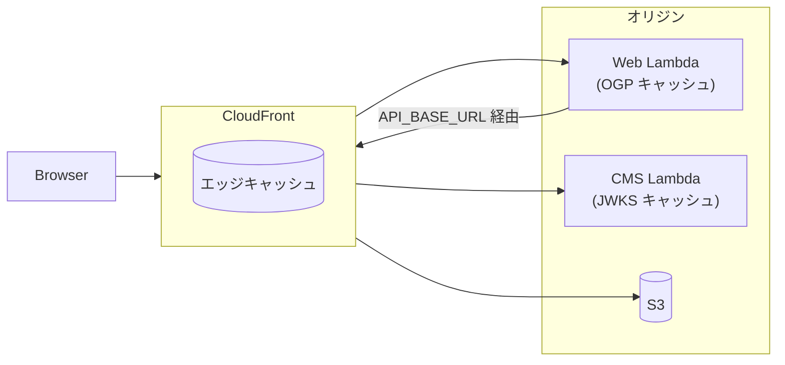
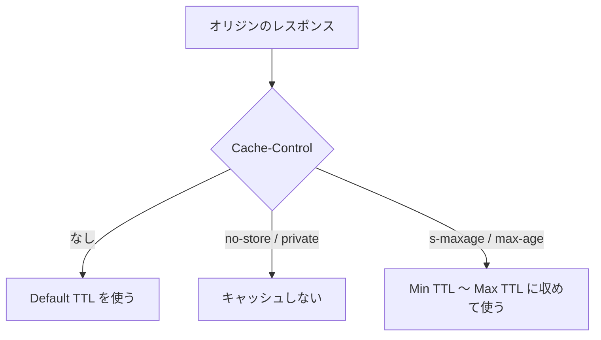
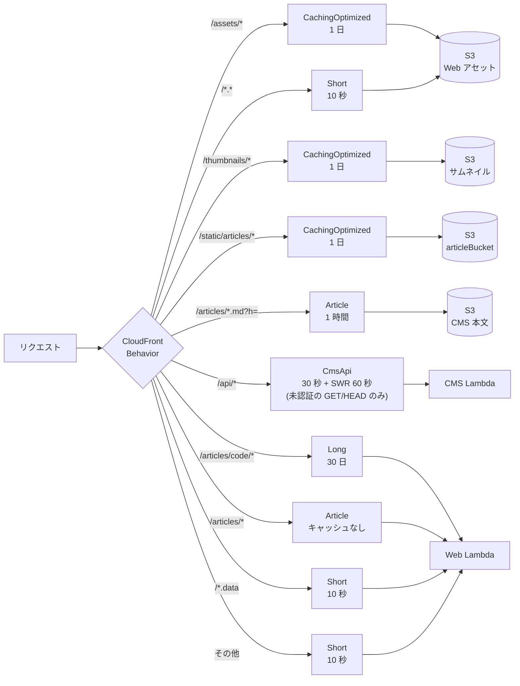
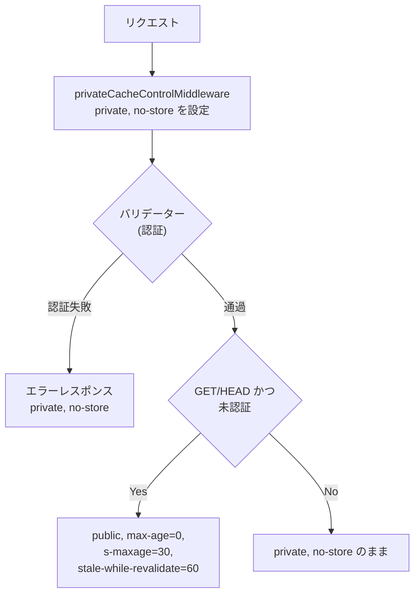
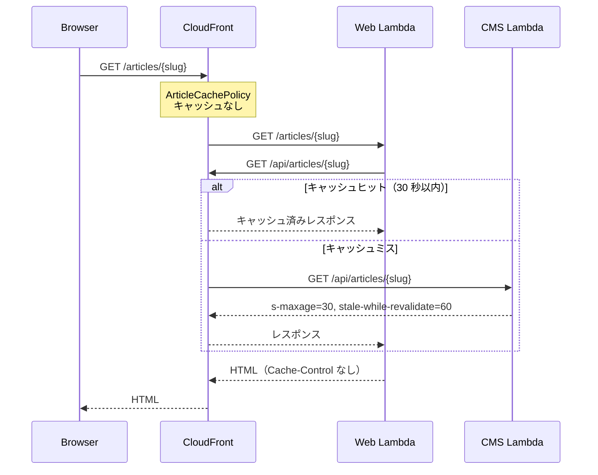
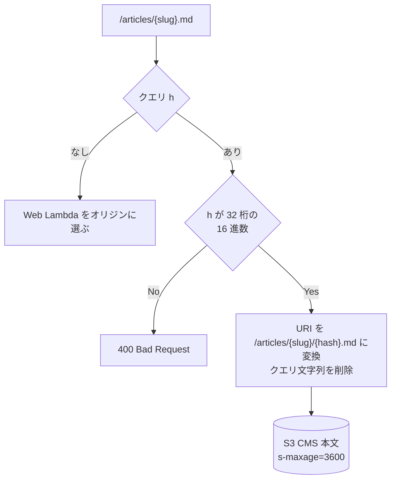
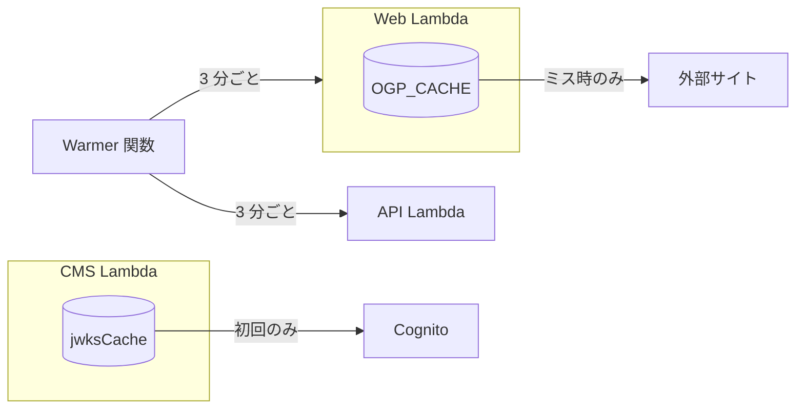
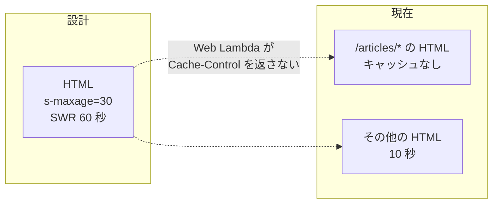

# キャッシュ戦略

現在の実装におけるキャッシュの構成をまとめる。設計方針は `cms/docs/networking.md` を参照する。

## 1. 概要

キャッシュは次の 3 層で行う。

| 層 | 実装箇所 |
|---|---|
| CloudFront | `infrastructure/lib/app-stack.ts` の Cache Policy と Behavior |
| オリジンのレスポンスヘッダー | CMS (Go) の `Cache-Control`、S3 オブジェクトの `Cache-Control` |
| Lambda のメモリ | Web の OGP キャッシュ、CMS の JWKS キャッシュ |

CloudFront は、オリジンが `Cache-Control` を返す場合はその値（`s-maxage` を優先）を Cache Policy の Minimum TTL と Maximum TTL の範囲に収めて使う。返さない場合は Default TTL を使う。

## 2. Cache Policy

| Cache Policy | Min TTL | Default TTL | Max TTL | キャッシュキー |
|---|---|---|---|---|
| `LongCachePolicy` | 1 日 | 30 日 | 365 日 | パスのみ |
| `ShortCachePolicy` | 1 秒 | 10 秒 | 1 時間 | パス + 全クエリ文字列 |
| `CmsApiCachePolicy` | 0 | 0 | 1 日 | パス + 全クエリ文字列 + `KCMS-Authorization` ヘッダー |
| `ArticleCachePolicy` | 0 | 0 | 1 日 | パス + クエリ文字列 `h` |
| `CachingOptimized`（AWS マネージド） | 1 秒 | 1 日 | 365 日 | パスのみ |

すべての Cache Policy で Cookie はキャッシュキーに含めず、gzip と Brotli を有効にする。

## 3. パスごとのキャッシュ

| パス | オリジン | Cache Policy | オリジンの `Cache-Control` | CloudFront での実効 TTL |
|---|---|---|---|---|
| `/assets/*` | S3（Web アセット） | `CachingOptimized` | なし | 1 日 |
| `/*.data` | Web Lambda | `ShortCachePolicy` | なし | 10 秒 |
| `/api/*`（未認証の GET/HEAD） | CMS Lambda | `CmsApiCachePolicy` | `public, max-age=0, s-maxage=30, stale-while-revalidate=60` | 30 秒 + SWR 60 秒 |
| `/api/*`（上記以外） | CMS Lambda | `CmsApiCachePolicy` | `private, no-store` | キャッシュしない |
| `/thumbnails/*` | S3（サムネイル） | `CachingOptimized` | なし | 1 日 |
| `/static/articles/*` | S3（`articleBucket`） | `CachingOptimized` | なし | 1 日 |
| `/articles/code/*` | Web Lambda | `LongCachePolicy` | なし | 30 日 |
| `/articles/*.md?h={hash}` | S3（CMS 本文） | `ArticleCachePolicy` | `public, max-age=0, s-maxage=3600` | 1 時間 |
| `/articles/*.md`（`h` なし） | Web Lambda | `ArticleCachePolicy` | なし | キャッシュしない |
| `/articles/*` | Web Lambda | `ArticleCachePolicy` | なし | キャッシュしない |
| `/*.*` | S3（Web アセット） | `ShortCachePolicy` | なし | 10 秒 |
| 上記以外（HTML） | Web Lambda | `ShortCachePolicy` | なし | 10 秒 |

### CMS API (`/api/*`)

`cms/internal/handler/cache.go` のミドルウェアが `Cache-Control` を設定する。

1. `privateCacheControlMiddleware` が全レスポンスに `private, no-store` を設定する。認証失敗時のレスポンスにも適用するため、バリデーターより前に置く。
2. `publicCacheControlMiddleware` が、未認証の GET/HEAD に限り `public, max-age=0, s-maxage=30, stale-while-revalidate=60` で上書きする。

`KCMS-Authorization` ヘッダーをオリジンへ転送するため、`CmsApiCachePolicy` はこのヘッダーをキャッシュキーに含める。

Web の SSR は `API_BASE_URL`（CloudFront のドメイン）経由で CMS API を呼び出すため、SSR からの記事取得にも CloudFront のキャッシュが効く。

### ハッシュ付き Markdown (`/articles/*.md?h={hash}`)

CloudFront Functions の `markdown-router.js` が Viewer Request で次の処理を行う。

- `h` がない場合は Web Lambda をオリジンに選ぶ。
- `h` がある場合は `/articles/{slug}/{hash}.md` に URI を書き換え、クエリ文字列を削除して S3 へ転送する。
- `h` が 32 桁の 16 進数でない場合は 400 を返す。

本文は immutable なため、CMS は S3 への保存時に `Cache-Control: public, max-age=0, s-maxage=3600` を付与する（`cms/internal/content/s3.go`）。

## 4. ブラウザキャッシュ

明示的に `Cache-Control` を返すのは CMS API とハッシュ付き Markdown のみで、どちらも `max-age=0` とする。その他のレスポンスは `Cache-Control` を返さないため、ブラウザはヒューリスティックなキャッシュを行う。

## 5. Lambda のメモリキャッシュ

| 対象 | 実装 | 有効期間 |
|---|---|---|
| OGP 情報 | `web/app/features/articles/loaders/ogp.ts` の `OGP_CACHE`（URL をキーとする `Map`） | Lambda 実行環境の存続中。失敗結果は保存しない |
| Cognito の JWKS | `cms/internal/auth/cache.go` の `jwksCache` | Lambda 実行環境の存続中。初回取得後は再取得しない |

Warmer 関数が 3 分ごとに Web Lambda と API Lambda を呼び出すため、Web Lambda の実行環境とメモリキャッシュは保持されやすい。

## 6. Invalidation

CloudFront Invalidation は実行しない。デプロイ時も `aws s3 sync --delete` で Web アセットを同期するのみで、反映は TTL の失効に任せる。

## 7. 設計 (`cms/docs/networking.md`) との差分

設計では HTML も `public, max-age=0, s-maxage=30, stale-while-revalidate=60` とするが、現在の Web Lambda は `Cache-Control` を返さない。そのため次の動作となる。

- `/articles/*` の HTML は `ArticleCachePolicy` の Default TTL 0 が適用され、CloudFront でキャッシュされない。
- その他の HTML は `ShortCachePolicy` の Default TTL 10 秒でキャッシュされる。
